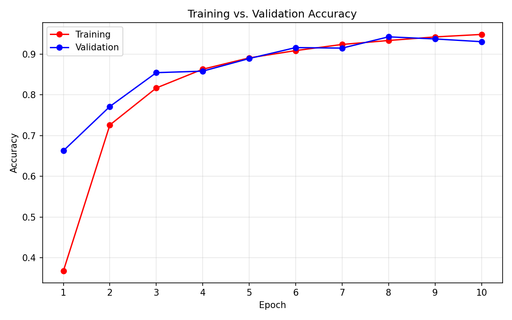
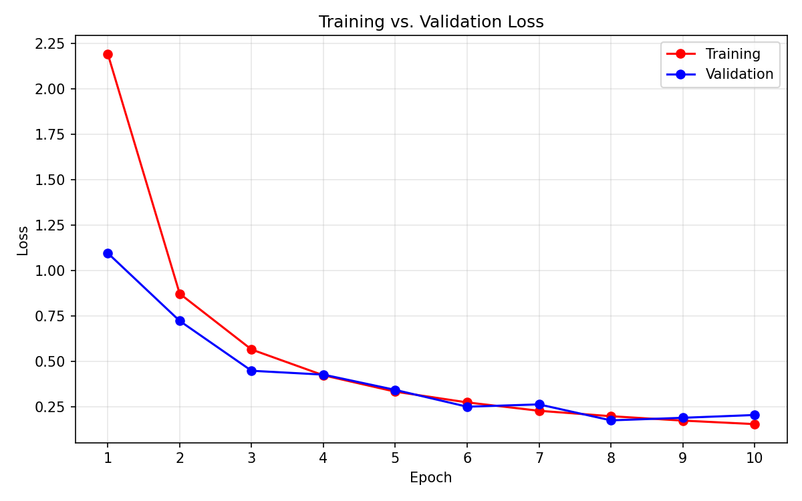

# Leaf Disease Prediction Using Deep Learning

Final Year Project — Plant Disease Recognition System, rebuilt to
research standard for scholarship applications.

- **Author:** Muhammad Asad Bukhari, BS IT, University of Education Lahore (DG Khan Campus), 2022–2026
- **Stack:** TensorFlow / Keras, scikit-learn, Streamlit, Python 3.12
- **Classes:** 38 (healthy + diseased, across Apple, Blueberry, Cherry, Corn, Grape, Orange, Peach, Pepper, Potato, Raspberry, Soybean, Squash, Strawberry, Tomato)

## Abstract

Plant diseases cause large crop losses, and early identification from a
leaf photograph can help farmers act before the disease spreads. This
project trains a convolutional neural network (CNN) to classify leaf
images into 38 healthy/diseased categories and serves the trained model
through a Streamlit web app. On the recorded 10-epoch training run the
model reached **98.18% training accuracy and 96.06% validation
accuracy**. The improved version adds a reproducible training script,
proper per-class evaluation, Grad-CAM explainability, and a
transfer-learning comparison (custom CNN vs. MobileNetV2 and
EfficientNetB0) so the work can be judged as research, not only as a
demo. A short research summary is in `docs/research-summary.md`.

## Problem

A farmer who notices a sick leaf usually has no quick, cheap way to
know which disease it is. Laboratory diagnosis is slow and costly, and
misidentification leads to the wrong treatment. The goal of this project
is a tool that takes one leaf photo and returns the most likely disease
with a confidence score — fast enough to use in the field.

## Dataset

The images come from the public **PlantVillage** dataset (Hughes &
Salathé, 2015), the standard open dataset for plant-disease image
classification.

| Split | Images |
|---|---|
| Train | 70,295 |
| Validation | 17,572 |
| Test (sample images in the original zip) | 33 |
| **Total** | **87,900** |

The full dataset (~88,000 images, 1.7 GB) is **not** in this repo —
GitHub does not host files that large. Download the full project zip
(code + dataset) from Google Drive:

- **[Plant Disease FYP.zip (1.7 GB) — Google Drive](https://drive.google.com/file/d/13_IbE48q2Nv3whIDxVf8OV60JzZGVySx/view?usp=sharing)**

After unzipping, the dataset folders are `train/`, `valid/`, and
`test/`, organised by class folder (e.g. `Tomato___Early_blight`).

## Methodology

### Architecture

Custom CNN (Sequential), reproduced exactly from the original training
notebook — including its quirk that the second convolution in the
128-filter block uses 32 filters, kept unchanged so results stay
comparable with the original run:

| Block | Layers |
|---|---|
| 1 | Conv2D 32, Conv2D 32, MaxPool 2×2 |
| 2 | Conv2D 64, Conv2D 64, MaxPool 2×2 |
| 3 | Conv2D 128, Conv2D 32, MaxPool 2×2 |
| 4 | Conv2D 256, Conv2D 256, MaxPool 2×2 |
| 5 | Conv2D 512, Conv2D 512, MaxPool 2×2 |
| Head | Dropout 0.25, Flatten, Dense 1500 (ReLU), Dropout 0.4, Dense 38 (softmax) |

### Training setup

- Input: 128×128 RGB images, batch size 32
- Optimiser: Adam, learning rate 0.0001
- Loss: categorical cross-entropy; metric: accuracy
- Epochs: 10 (original run)
- Augmentation (new in this version; the original had none): random horizontal flip, rotation (±10%), zoom (±10%) on the training set only
- Seed: 42 (see `src/train.py`)

### Evaluation and explainability

- `src/evaluate.py` — accuracy + per-class precision/recall/F1 and a confusion matrix on any labelled folder.
- `src/gradcam.py` — Grad-CAM heatmaps showing which part of the leaf drove a prediction.
- `src/compare_models.py` — same data pipeline, three models: custom CNN, MobileNetV2 (ImageNet), EfficientNetB0 (ImageNet); results in `results/model_comparison.csv`.

## Results

These are the **verified numbers from the original run**
(`results/training_history.json`, 10 epochs). No other accuracy figure
is claimed anywhere in this project.

| Metric | Epoch 1 | Final (epoch 10) |
|---|---|---|
| Training accuracy | 61.50% | **98.18%** |
| Validation accuracy | 83.68% | **96.06%** |
| Training loss | 1.293 | 0.057 |
| Validation loss | 0.523 | 0.138 |




Per-class precision/recall/F1 and a held-out test-set evaluation are
**pending retraining** — the original zip contains no trained model
file (see Known limitations), so the classification report in
`results/` will be produced by `src/train.py` on the retraining run.
Do not quote test-set numbers until that run exists.

## Reproducibility

Full training needs a GPU. The steps are in
[`docs/COLAB_TRAINING.md`](docs/COLAB_TRAINING.md) (Google Colab, free
GPU). In short:

```bash
git clone https://github.com/Asadshah-coder/leaf-disease-prediction.git
cd leaf-disease-prediction
# put the dataset in data/ (train/, valid/, test/)
pip install -r requirements.txt
python src/train.py --data-dir data --epochs 10
streamlit run main.py
```

Plot the training curves from an existing history file:

```bash
python src/plot_results.py
```

Evaluate a trained model and explain one prediction:

```bash
python src/evaluate.py --model trained_plant_disease_model.keras --data-dir data/valid
python src/gradcam.py --model trained_plant_disease_model.keras --image path/to/leaf.jpg --output results/gradcam.png
```

## How to run the app

```bash
pip install -r requirements.txt
streamlit run main.py
```

Then upload up to 3 leaf images in the Disease Recognition section and
press Predict. A prediction is shown only when the model's top
confidence is **≥ 80%** (kept from the original project). If no model
file is present, the app explains how to get one instead of crashing.

## Known limitations

1. **Trained model file missing in the original zip.** `main.py` and
   the Test notebook load `trained_plant_disease_model.keras`, but that
   file was not in the original project zip, and the original training
   notebook saved the model as `trained_model.keras` (name mismatch).
   Fixed in this version: `src/train.py` saves with the correct name,
   and `main.py` loads the model once (cached) and falls back to
   `trained_model.keras` if the preferred name is absent — but until a
   model is retrained, predictions cannot run.
2. **Test set is only 33 images.** The original zip's `test/` folder
   is a small sample set, not a proper held-out test set. Test-set
   numbers must come from a proper split in the retraining run; the
   validation set was also (incorrectly) used as the test set in the
   old Test notebook.
3. **No data augmentation in the original run.** Added in `src/train.py`.
4. **No per-class metrics were recorded originally.** Added via
   `src/evaluate.py`; results pending retraining.
5. **Single train/validation split, no cross-validation.** Noted as future work.

## Future work

- Retrain on Colab and publish the verified test-set classification report.
- Complete the MobileNetV2 / EfficientNetB0 comparison and report it in `results/model_comparison.csv`.
- Add cross-validation and a proper held-out test split.
- Try a larger input resolution (e.g. 224×224) for the transfer-learning models.
- Deploy the app (Streamlit Cloud / Hugging Face Spaces) with the trained model.
- Test on real field photographs (different lighting/backgrounds) to check robustness outside the PlantVillage distribution.

## Project structure

```
.
├── main.py                     # Streamlit app (model loaded once, cached)
├── home_page.png.png           # Banner image used by the app
├── index.html, disease_recognition.html   # Static HTML pages (original)
├── requirements.txt
├── .gitignore
├── src/
│   ├── model.py                # Custom CNN definition + class names
│   ├── train.py                # Reproducible training + evaluation
│   ├── evaluate.py             # Standalone model evaluation
│   ├── gradcam.py              # Grad-CAM explainability
│   ├── compare_models.py       # Custom CNN vs. MobileNetV2 vs. EfficientNetB0
│   └── plot_results.py         # Accuracy/loss figures
├── notebooks/
│   ├── Train_plant_disease.ipynb   # Original training notebook (unchanged)
│   └── Test_Plant_Disease.ipynb    # Original test notebook (unchanged)
├── results/
│   ├── training_history.json   # Verified 10-epoch history (original run)
│   └── figures/                # accuracy.png, loss.png (from plot_results.py)
└── docs/
    ├── COLAB_TRAINING.md       # Step-by-step Colab retraining guide
    └── research-summary.md     # Short research summary for applications
```
